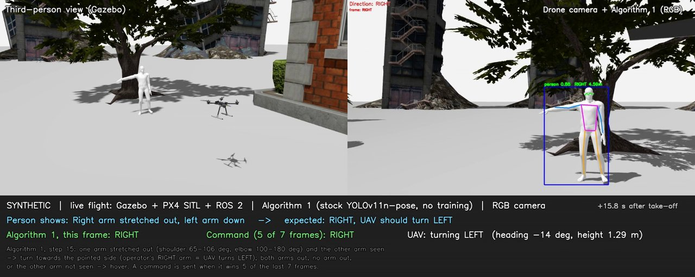
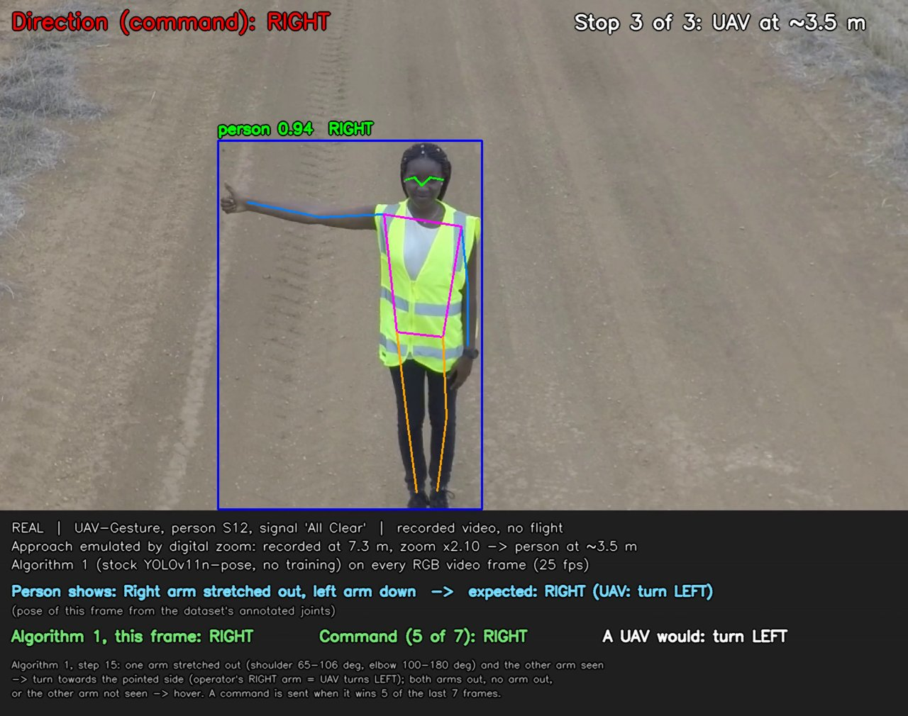

# UAVFramework_SAR: a ROS 2 human-in-the-loop framework for UAV search and rescue

Code, results and simulation for the paper *"A ROS2 based Human-In-The-Loop Framework for UAV
Search and Rescue Operations"* (A. Pandey, H. Nagpal, A. Agarwal, T. Alladi, F. R. Yu).

A UAV in Gazebo Harmonic + PX4 SITL + ROS 2 sees a rescuer, reads an arm gesture with YOLOv11-pose
from its RGB or depth camera, and turns towards the side the rescuer points to (the rescuer's
right arm turns the UAV left, since they face each other), or hovers. The repository contains the
ROS 2 nodes, the simulated SAR worlds and people, an interactive desktop demo, the modified
YOLOv11 (YOLOv11-ℒ_total) with its training data generator and training script, the depth-weighted
pose estimation of Eq. (1)–(2), the evaluation scripts and the logged results of the paper.

[](media/simulation_demo.mp4)

**Demo video** ([`media/simulation_demo.mp4`](media/simulation_demo.mp4), 2 min): live flights in
Gazebo + PX4 SITL + ROS 2 with Algorithm 1 (stock YOLOv11n-pose, RGB camera). Left: third-person
view; right: the drone camera with the detected pose; below: the gesture read in the frame, the
command (sent when a gesture wins 5 of the last 7 frames at 10 Hz) and what the UAV does. The
person shows the right arm (UAV turns left), the left arm (UAV turns right), then both arms down
(UAV hovers).

[](media/real_dataset_demo.mp4)

**Real-people video** ([`media/real_dataset_demo.mp4`](media/real_dataset_demo.mp4), 1.5 min):
recorded videos of three real people from the UAV-GESTURE dataset (Perera et al., 2018), used as the
drone's camera stream, with the same Algorithm 1 and 5-of-7 command (no flight). The UAV's approach
is emulated by digital zoom, as in the demo's "Real people" mode: the person is shown at about
6.5 m, 5 m and 3.5 m, and at each distance shows both arms down (UAV hovers), the right arm (UAV
turns left) and the left arm (UAV turns right). The expected direction of each frame comes from the
dataset's annotated joints. The dataset has no left-arm-only pointing, so the left-arm parts are
right-arm videos mirrored, as in Table 14. In these signals ("All Clear", "Not Clear") the arm is
stretched out and lowered about once a second, so the command follows each change after a few
frames. Excerpts chosen with the arm inside the range of Algorithm 1: correct in 98% of the frames,
command correct in 91%. Over all UAV-GESTURE videos see Table 14 (`results/`). Rebuilt with
`python3 eval/gesture_videos.py approach media/real_dataset_demo.mp4` (UAV-GESTURE needed).

## Repository

| Folder / file | What |
|---|---|
| `src/drone_control` | ROS 2 package: gesture node (Algorithm 1, `pdd.py`), depth-weighted pose estimation of Eq. (1)–(2) (`fusion.py`), YOLOv11-ℒ_total (`rgbd_model.py`, `t4_model.py`), control node (PX4 offboard), sensor simulation (Koschmieder fog, RealSense D435i noise), launch file, unit tests |
| `src/sar_sim` | Gazebo worlds (City, Forest, Wall and their particle-fog versions), SAR human models, drone variants, generators |
| `eval/` | Desktop demo; evaluation scripts (simulated test set, UAV-GESTURE in fog, λ tuning, closed-loop flights, tables, videos) |
| `train/` | Training data generator (humans, worlds, captures, clips), dataset builders (synthetic and UAV-GESTURE), `train.py`, and `PROTOCOL.md`, the test protocol written before each run |
| `results/` | **Logged results of the paper**: per-frame results behind Tables 13 and 14, λ tuning, training curves, trained weights, closed-loop flights; `results/README.md` |
| `media/` | Demo videos: simulation (Gazebo + PX4 + ROS 2) and real people (UAV-GESTURE) |
| `install_system.sh`, `install_workspace.sh`, `px4_env.sh` | Installation and environment (`source px4_env.sh` in every terminal) |
| `run_simulation.sh`, `stop_simulation.sh` | **Start / stop the simulation** (Gazebo, PX4 SITL, QGroundControl, ROS 2 nodes), see below |
| `THIRD_PARTY.md` | Licences of the bundled Gazebo models and meshes, and of the dataset excerpts in `media/` |
| `RUN_SAR.md` | Starting every component by hand, one terminal each |

## Results

All numbers below are recomputed from the per-frame logs with `python3 results/make_tables.py`
(see `results/TABLES.md`). Direction accuracy %, false commands % in brackets (LEFT or RIGHT for a
NEUTRAL gesture).

| | Clear | Particle fog | Koschmieder V 10 m |
|---|---|---|---|
| Simulated test set (City, Forest, Wall): Algorithm 1, RGB | 71 (4) | 28 (0) | 43 (0) |
| Algorithm 1, depth | 61 (0) | 36 (0) | 55 (0) |
| Algorithm 1, fused pose Eq. (1)–(2) | 76 (5) | 41 (0) | 57 (0) |
| YOLOv11-ℒ_total, synthetic-trained | 91 (11) | 86 (13) | 88 (21) |
| Real people (UAV-GESTURE, 11 subject IDs): Algorithm 1, RGB | 80 (19) | – | 24 (1) |
| Algorithm 1, depth estimated from RGB | 80 (17) | – | 77 (18) |
| YOLOv11-ℒ_total, real-trained (4 held-out subject IDs) | 99 (0) | – | 1 (0) |

Algorithm 1 uses the stock YOLOv11n-pose without training. In six closed-loop flights,
YOLOv11-ℒ_total sent the command 0.33–0.66 s after a gesture change and the UAV started turning
after 1.03–1.30 s (`results/closed_loop_flights/`).

## Tested setup

| | |
|---|---|
| OS | Ubuntu 22.04 (required by ROS 2 Humble and these Gazebo packages) |
| Middleware / simulator | ROS 2 Humble, Gazebo Harmonic (Gazebo Sim 8.15), PX4 v1.15.4 SITL, Micro XRCE-DDS Agent v2.4.2 |
| Python | 3.10, PyTorch 2.4.1 (CUDA 11.8), Ultralytics 8.4.13, NumPy 1.26.4, OpenCV 4.8.1 |
| Models | stock COCO YOLO11n-pose; Depth-Anything-V2 metric outdoor small (real-video depth only) |
| Hardware | 2× NVIDIA RTX 4000 SFF Ada (20 GB) |

The demo also runs on a single NVIDIA GPU; without a GPU, YOLO runs on the CPU and Gazebo renders
in software (slow).

## Installation

```bash
git clone https://github.com/anubhavml/UAVFramework_SAR.git
cd UAVFramework_SAR
bash install_system.sh                         # sudo: ROS 2 Humble, Gazebo Harmonic, PX4 build tools
# log out and back in (GPU render group), then:
bash install_workspace.sh                      # sources at fixed versions, Python packages, models, builds
source px4_env.sh                              # in every new terminal
```

`install_workspace.sh` clones PX4-Autopilot v1.15.4, px4_msgs v1.15.4, px4_ros_com (release/1.15,
86e9aeb) and Micro-XRCE-DDS-Agent v2.4.2, installs the Python packages (`train/requirements.txt`,
pinned via `external/pip-constraints.txt`), downloads YOLO11n-pose and the depth model to
`external/models/`, builds PX4 SITL and the ROS 2 workspace and runs the unit tests. For GPUs that
need newer CUDA wheels: `TORCH_CUDA=cu128 bash install_workspace.sh`.

**Optional**

- **QGroundControl 4.4.4** (ground station window in the demo):
  ```bash
  curl -L -o external/QGroundControl-4.4.4.AppImage \
    https://github.com/mavlink/qgroundcontrol/releases/download/v4.4.4/QGroundControl.AppImage
  chmod +x external/QGroundControl-4.4.4.AppImage
  ```
  (Newer QGroundControl releases need a newer glibc than Ubuntu 22.04 has.)
- **VirtualGL** (only for remote desktops without hardware OpenGL, e.g. a server's onboard
  graphics): install the `virtualgl` package from https://github.com/VirtualGL/virtualgl/releases;
  the demo then draws the Gazebo and QGroundControl windows on GPU 0.
- **UAV-GESTURE dataset** (the demo's "Real people" option and the real-people evaluation): obtain
  it from its authors, https://asankagp.github.io/uavgesture/ (academic research only), or from
  OpenDataLab, https://opendatalab.com/OpenDataLab/UAV-Gesture, and place it as
  ```
  UAVGesture/<Class>/<video>.mp4                                   e.g. UAVGesture/Hover/S11_hover_HD.mp4
  UAVGesture/joint_positions/<class>/<video>/<video>.mat
  ```
  (or set `UAVGESTURE_DIR` to another location). Everything else works without it.


## Running the simulation

```bash
source px4_env.sh
./run_simulation.sh                 # start window: choose the options, then "Start demo"
./run_simulation.sh [options]       # or start directly with options (./run_simulation.sh --help)
./stop_simulation.sh                # stop everything (also closes the terminals)
```

The simulation opens one terminal window per component (about 1.5 min until everything is up):

| Window | Component |
|---|---|
| Terminal 1 | Micro XRCE-DDS Agent (PX4 ↔ ROS 2) |
| Terminal 2 | Gazebo server (headless, renders the cameras) and the Gazebo GUI |
| Terminal 3 | PX4 SITL (`pxh>` shell); the barometer is set as height reference |
| QGroundControl | ground station, if installed (see Installation) |
| Terminal 4 | `ros2 launch drone_control sar_hitl.launch.py`: Gazebo ↔ ROS 2 bridge, gesture node (drone camera window "Unified-PDD" with the detected pose, the frame label and the command), control node (PX4 offboard), and `sensor_sim` for camera fog |
| Terminal 5 | demo driver: the UAV takes off at the first distance, moves towards the person and stops at each distance, where the person shows each gesture; a "Demo status" window shows the expected and the actual reaction (with `--panel`: a "Demo control" window with buttons instead) |

The UAV reacts only through the gesture node: the person's gesture → perception → command → PX4.

| Option | Values | |
|---|---|---|
| `--source` | `synthetic` (default), `real` | synthetic person in Gazebo, or the UAV-GESTURE videos as the drone's camera stream (dataset needed); the simulated UAV flies and reacts in both cases |
| `--mode` | `rgb` (default), `depth`, `fused`, `rgbd` | Algorithm 1 with the stock YOLOv11n-pose on the RGB or the depth image, Algorithm 1 on the depth-weighted fused pose of Eq. (1)–(2), or YOLOv11-ℒ_total on RGB + depth. With real videos the depth is estimated from each frame (Depth-Anything-V2) |
| `--model` | path | weights for `--mode rgbd` (default `results/weights/yolov11_ltotal_synthetic.pt`) |
| `--world` | `city` (default), `forest`, `wall`, `city_fog`, `forest_fog`, `wall_fog` | Gazebo world; `*_fog` = Gazebo particle fog, as in the paper's fog worlds |
| `--fog-density` | e.g. `1.0` (default), `0.5`, `0.25` | particle fog density relative to the paper's fog worlds (1.0: gestures read at about 3 m; 0.5 up to about 5 m; 0.25 almost clear) |
| `--visibility` | metres, e.g. `50`, `20`, `10`, `5`; `0` = off (default) | camera fog by Koschmieder's law, as in the paper's fog tests; on the camera images (drone camera window), synthetic and real |
| `--distances` | e.g. `10,7,5,3` (synthetic default), `6.5,5,3.5` (real default) | the UAV starts at the first distance and stops at the others; with real videos the approach is emulated by digital zoom |
| `--gestures` | e.g. `right,left,both_out` (default) | shown at every stop: `right`, `left`, `neutral`, `both_out`, `both_up`, `rightout_leftup`, `leftout_rightup` |
| `--react` | `turn` (default, paper), `fly` | turn towards the pointed side while the arm is out (up to 20°), or turn `--fly-turn` degrees, fly `--fly-distance` m there and wait for "come back" |
| `--once` | | one pass instead of repeating |
| `--panel` | | buttons instead of the automatic sequence |
| `--no-qgc`, `--no-terminals` | | without QGroundControl; components in the background (logs in `eval/data/gui_demo/logs`) |

Examples:

```bash
./run_simulation.sh                                          # start window
./run_simulation.sh --mode rgb                               # synthetic person, RGB, City, clear
./run_simulation.sh --world forest --mode depth              # depth camera in the Forest
./run_simulation.sh --world wall_fog --mode fused            # particle fog, fused RGB-D pose
./run_simulation.sh --world city --visibility 20 --mode rgbd # Koschmieder fog V = 20 m, YOLOv11-ℒ_total
./run_simulation.sh --source real --mode rgb                 # real people (UAV-GESTURE), RGB
./run_simulation.sh --source real --mode fused --visibility 20
./run_simulation.sh --panel --react fly                      # control the UAV with buttons
```

Notes:

- The operator's right arm points to the UAV's left (they face each other), so it turns left.
- Fog: the arms have to be visible, so in fog the UAV has to come closer. Camera fog: V = 30 m or
  more is close to clear air; 20 m up to about 5 m; 10 m about 3 m; at 5 m the RGB camera no
  longer reads gestures.
- With real videos the UAV flies in Gazebo while its camera stream is the video; the clips were
  recorded at 6.5–8.4 m, so the person never appears farther. When the UAV has turned away from the
  person the camera shows nothing.
- Environment variables: `SAR_TERMINAL` (gnome-terminal, konsole, xfce4-terminal or xterm),
  `QGC_APPIMAGE` (path to QGroundControl), `SAR_VGL=0` (do not use VirtualGL).
- Every component can also be started by hand, one terminal each: `RUN_SAR.md`.
- How the videos in `media/` were made: `simulation_demo.mp4` records live flights
  (`eval/run_gesture_videos.sh`: `eval/run_flight.sh` with `RECORD=1` runs Gazebo + PX4 SITL + ROS 2
  and saves the frames, `eval/gesture_videos.py synthetic` adds the captions). `real_dataset_demo.mp4`
  is rendered without the simulator (`eval/gesture_videos.py approach`): it runs the same Algorithm 1
  on the recorded UAV-GESTURE frames and scores each frame against the dataset's joint annotations,
  which a live run cannot do. To fly the simulated UAV with these videos, use `--source real`.

## Gesture recognition

**Algorithm 1** (`src/drone_control/drone_control/pdd.py`; the gesture node calls its pipeline "Unified-PDD") on the 17 COCO keypoints of YOLOv11-pose: an arm counts
as stretched out when its shoulder angle ∠(hip, shoulder, elbow) is in [65°, 106°] and its elbow
angle ∠(shoulder, elbow, wrist) in [100°, 180°], and as detected when its shoulder and elbow
keypoint confidence is at least 0.5. Left and right are read as the UAV sees them. One arm out with
the other arm detected gives that direction; both arms out, no arm out, or the other arm not seen
gives NEUTRAL (hover). The gesture node sends a command when a direction wins 5 of the last 7 frames.

| Launch | Configuration |
|---|---|
| `ros2 launch drone_control sar_hitl.launch.py` | Algorithm 1, RGB |
| `... input_mode:=depth` | Algorithm 1, depth camera |
| `... input_mode:=fused` | Algorithm 1 on the depth-weighted fused pose, Eq. (1)–(2), λ = 3000 (gesture node parameter `fusion_lambda`) |
| `... input_mode:=rgbd model:=$ROSWS/results/weights/yolov11_ltotal_synthetic.pt` | YOLOv11-ℒ_total |
| `... visibility:=20` | with camera fog, V = 20 m (any of the above) |

`robust:=true` adds further robustness steps that are not part of the paper (`RUN_SAR.md`).

**YOLOv11-ℒ_total** (`rgbd_model.py`, `t4_model.py`; called T4 in `train/`, and T4R when trained on
real UAV-GESTURE subject IDs instead of synthetic data) keeps every
YOLOv11n-pose layer with its COCO weights, changes the classes to LEFT, RIGHT and NEUTRAL, and adds:
a depth stream whose stride-8/16/32 features are added after layers 4, 6 and 10 through
zero-initialised 1×1 convolutions (depth-aware FPN), a cross-scale attention on the three neck
outputs with zero-initialised gains, a distance head, and the loss

ℒ_total = 7.5 ℒ_CIoU + 1.5 ℒ_DFL + 0.5 ℒ_BCE + 12 ℒ_kpt + 1.0 ℒ_kobj + 1.0 ℒ_depth + 1.0 ℒ_temporal

(the first five weights are the Ultralytics defaults; ℒ_depth = L1 of the predicted person
distance, ℒ_temporal = mean squared deviation of a person's gesture logits over a 4-frame clip).
3.52 M parameters, 10.0 GFLOPs at 640×640. T1–T3 are intermediate stages (T1 = gesture classes,
T2 = + depth stream, T3 = + attention, T4 = + ℒ_depth and ℒ_temporal).

## Reproducing the results

The results of the paper are in `results/`. These steps run the same evaluation from scratch;
their outputs (`eval/data/`, `train/results/FINAL_TABLES.md`, `eval/data/flights/FLIGHTS.md`) hold
the same tables, and `results/` is a cleaned copy of these outputs. Simulation steps start Gazebo
headless (and PX4 SITL and ROS 2 for flights), one at a time. `--device 0` is the GPU.

```bash
source px4_env.sh
# 1. Simulated test set: City, Forest, Wall and their fog versions, seed 1 (never used for training)
SEED=1 OUT=$ROSWS/eval/data/captures_test eval/run_capture.sh

# 2. Synthetic training data: humans, worlds (included in train/worlds), frames, clips, datasets
cd train
../external/px4-venv/bin/python make_humans.py
./run_capture_train.sh && ./run_capture_clips.sh
python3 build_dataset.py && python3 build_t4.py
python3 train.py T4 --device 0                        # -> train/runs/T4/weights/best.pt
# real-trained model (UAV-GESTURE needed): subject IDs S4, S6, S9, S12, S15 train, S5, S13 validation
python3 build_real.py && python3 build_real_t4.py && python3 train.py T4R --device 0
cd ../eval

# 3. Simulated test set: Algorithm 1 (RGB, depth), the fused pose (λ chosen on the validation
#    worlds by tune_fusion.py), YOLOv11-L_total
python3 evaluate.py --captures data/captures_test --rules --fix --device 0 --out data/results_test_uavview/frames.csv
python3 tune_fusion.py --device 0
python3 evaluate.py --captures data/captures_test --only-fused --fused 3000 --device 0 --out data/results_test_fused/frames.csv
mkdir -p ../train/results
python3 evaluate.py --captures data/captures_test --only-trained --device 0 \
    --trained "T4=$ROSWS/train/runs/T4/weights/best.pt:rgbd" --out ../train/results/frames_T4.csv

# 4. Real people in Koschmieder fog (UAV-GESTURE), original and mirrored
for m in "" --mirror; do
  python3 uavgesture_fog.py run --device 0 $m
  python3 uavgesture_fog.py run --trained --device 0 $m
  python3 uavgesture_fog.py run --fused 3000 --device 0 $m
done
python3 final_tables.py --fused-lambda 3000            # -> train/results/FINAL_TABLES.md

# 5. Closed-loop flights of YOLOv11-L_total (Gazebo + PX4 SITL + ROS 2)
for w in city forest wall city_fog forest_fog wall_fog; do
  ./run_flight.sh ${w}_T4 $w x500_depth model:=$ROSWS/train/runs/T4/weights/best.pt input_mode:=rgbd device:=0
done
python3 flight_report.py data/flights                  # -> data/flights/FLIGHTS.md
```

Training data format (to train on other data): Ultralytics pose layout with 3 classes
(`names: {0: LEFT, 1: RIGHT, 2: NEUTRAL}`, `kpt_shape: [17, 3]`), 4-channel B, G, R, D `.tiff`
images for T2–T4 (depth 0.1–20 m mapped to 0–255, `drone_control.rgbd_model.to_rgbd`), and for T4
`dist/<split>/` (one distance in metres per labelled person) and `clips_train.npy`
(clips, 4, 384, 640, 4) with `clips_train_boxes.npy` (`train/build_t4.py`). Horizontal flips are
off: a mirrored image turns LEFT into RIGHT.

## License

The code in this repository is licensed under the GNU Affero General Public License v3.0 only
(AGPL-3.0-only); see `LICENSE`. This matches Ultralytics YOLO, which the gesture pipeline uses. The
bundled Gazebo models and meshes, and the dataset excerpts in `media/`, keep their own licences:
see `THIRD_PARTY.md`.

## Third-party components and data

This repository uses, but does not include: PX4-Autopilot, px4_msgs, px4_ros_com,
Micro XRCE-DDS Agent, ROS 2, Gazebo, Ultralytics YOLO11 (AGPL-3.0), Depth-Anything-V2, and
optionally QGroundControl, VirtualGL and the UAV-GESTURE dataset (A. G. Perera, Y. W. Law,
J. Chahl, "UAV-GESTURE: A dataset for UAV control and gesture recognition", ECCV Workshops, 2018);
each under its own licence (`THIRD_PARTY.md`).
